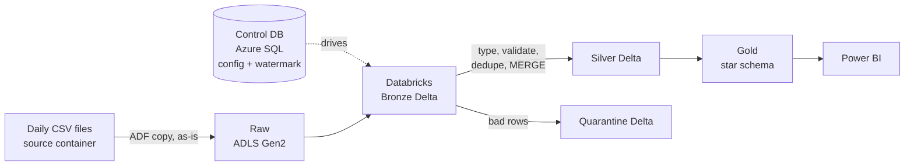
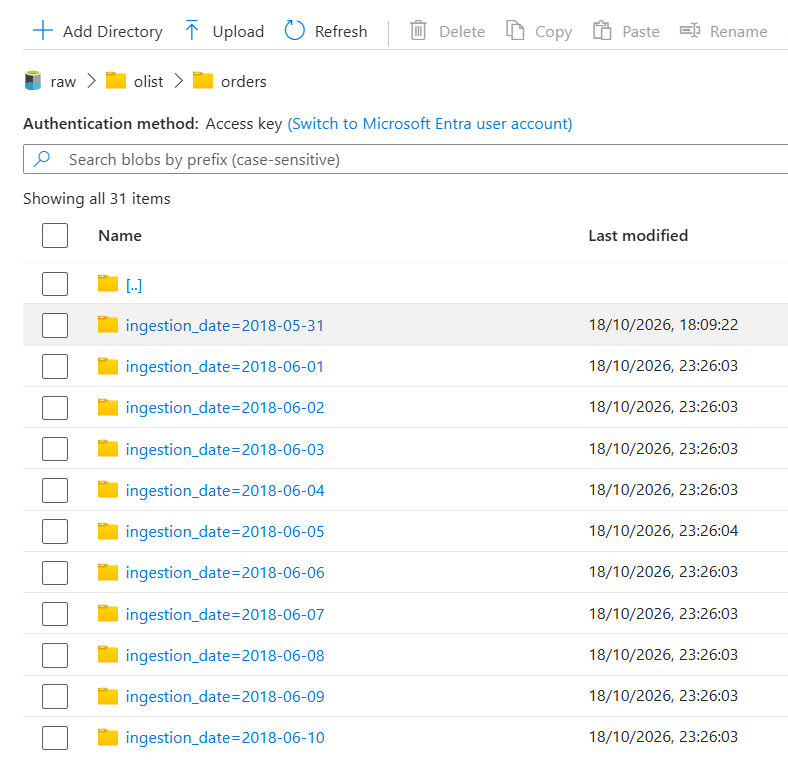
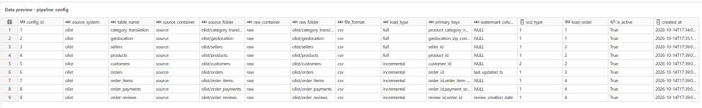
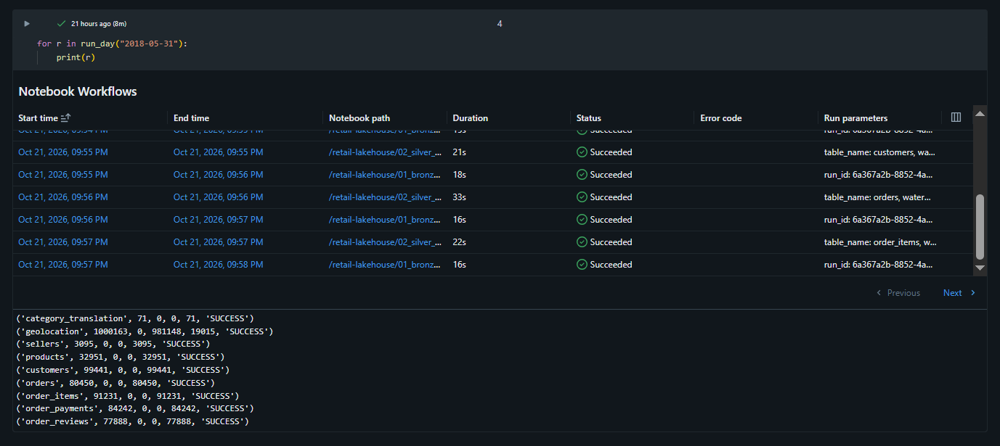
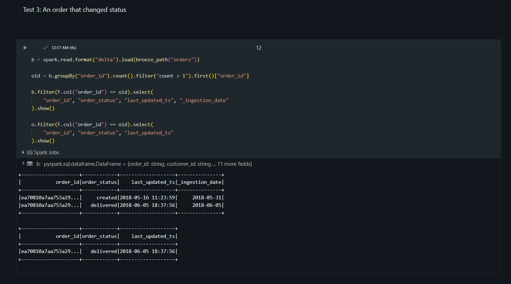
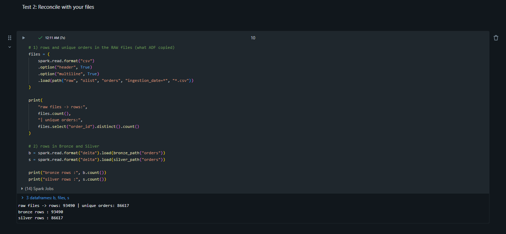
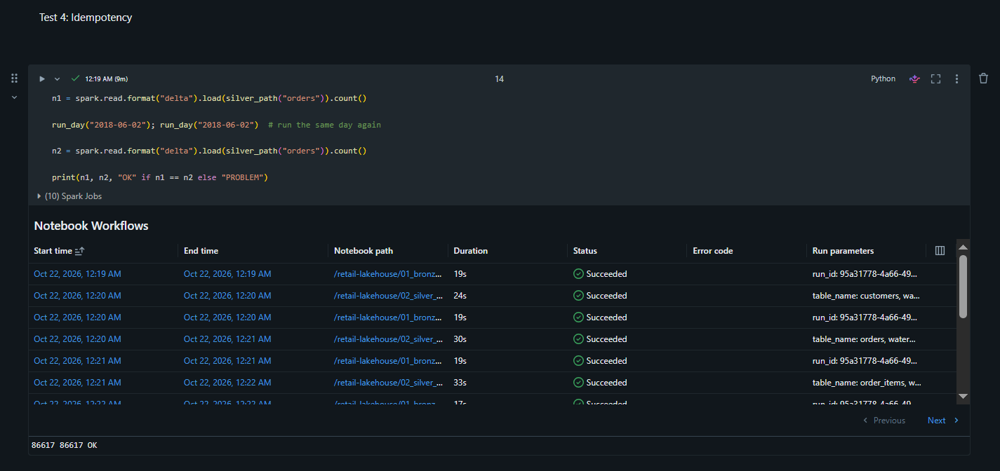
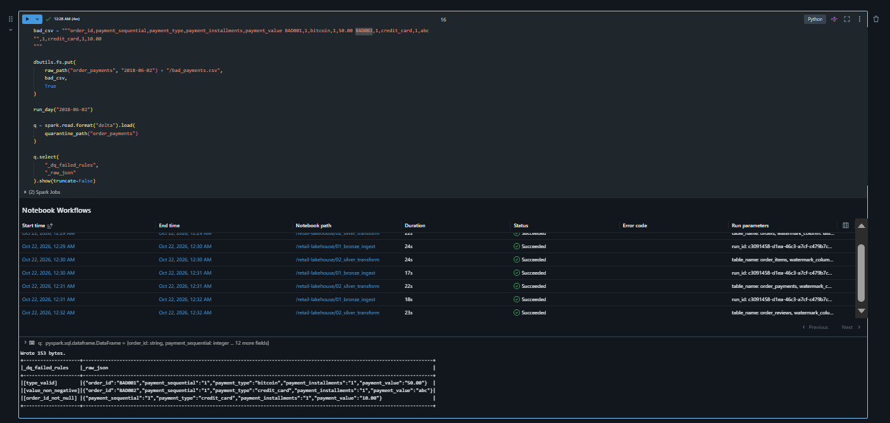

# Retail Lakehouse: Metadata-Driven Incremental Pipelines on Azure

An end-to-end data engineering project that builds a **Bronze / Silver / Gold lakehouse** on Azure using the Olist Brazilian e-commerce dataset. Files arrive as simulated daily batches and are loaded **incrementally and idempotently** by one **metadata-driven** pipeline.

> **Status:** Work in progress. Phases 1–2 are complete (ingestion, Bronze, Silver, data quality). See the [Roadmap](#roadmap).

---

## Architecture



### Layers

| Layer | Container | Content |
|---|---|---|
| Source | `source` | Simulated external system (daily CSV files) |
| Raw | `raw` | Exact copy of the files, never edited (replay safety net) |
| Bronze | `bronze` | Delta, all columns as strings, plus technical columns |
| Silver | `silver` | Typed, validated, deduplicated Delta tables |
| Quarantine | `silver/_quarantine` | Rejected rows with the reason and the original row |
| Gold | `gold` | Star schema and aggregates *(planned)* |

---

## Tech stack

- Azure Data Lake Storage Gen2
- Azure Data Factory
- Azure Databricks
- PySpark
- Delta Lake
- Azure SQL Database (control tables)
- Python
- SQL
- Git/GitHub

*Planned: Azure Key Vault, Power BI, CI/CD.*

---

## Dataset and daily-batch simulation

Source: [Olist Brazilian E-Commerce dataset](https://www.kaggle.com/datasets/olistbr/brazilian-ecommerce) on Kaggle.

The dataset is not included in this repo. Please download it from Kaggle.

Olist is a static dataset, so `data_prep/split_olist.py` turns it into a realistic daily feed:

- **History load:** everything before 2018-06-01 goes into one folder dated `2018-05-31`.
- **Daily files:** 1–30 June 2018, one folder per day: `ingestion_date=YYYY-MM-DD/`.
- **Order updates:** an order appears first as `created`, then again later with its final status. A `last_updated_ts` column is added as the watermark.
- **Simulated customer address changes** are added on some days, to demonstrate SCD Type 2 later.

> The order updates and address changes are **simulated**. They are not original Olist events.

---

## Repository structure

```
retail-lakehouse-azure/
├── README.md
├── data_prep/
│   └── split_olist.py          # builds daily batch files from the Kaggle CSVs
├── sql/
│   └── 01_control_tables.sql   # ctl.pipeline_config + ctl.watermark_state
├── notebooks/
│   ├── 00_common.py            # paths, column types, data quality rules
│   ├── 01_bronze_ingest.py     # raw CSV -> Bronze Delta
│   ├── 02_silver_transform.py  # Bronze -> typed, validated, MERGE into Silver
│   ├── 03_dev_runner.py        # loops tables and dates (stands in for ADF during development)
└── DOCS/
    └── screenshots/
```

---

## Key design decisions

| Decision | Why |
|---|---|
| **Config table + state table are separate** | Config changes by deployment; watermark changes every run. Separate tables stop a config update from overwriting the watermark. |
| **One parameterized notebook set works for all 9 tables** | Adding a table means inserting one config row. |
| **Raw layer is a binary copy** | ADF does not parse anything, so raw stays exactly as received and odd characters cannot break the copy. |
| **Managed identity, no keys** | ADLS and Databricks reach storage without secrets to leak or rotate. |
| **Loading never fails because of a bad value** | Typing happens in Silver; bad values become NULL and are flagged for quarantine. |
| **Two watermarks** | Ingestion date is the file-level watermark (which day to load). `last_updated_ts` is the record-level watermark (which version is newest). |
| **MERGE with `s.last_updated_ts >= t.last_updated_ts`** | A late or old file cannot overwrite a newer record. |
| **Deduplicate before MERGE** | Delta MERGE fails when two source rows match one target row. |
| **Full vs incremental** | Full tables are replaced with a snapshot. Incremental tables are upserted with MERGE. |

---

## Idempotency

Re-running the same day must not create duplicates:

- **Bronze:** `replaceWhere` on `_ingestion_date` replaces only that day's rows.
- **Silver:** MERGE on the primary key updates the same row.
- **Quarantine:** `replaceWhere` on `_ingestion_date` clears and rewrites that day's rejects.

---

## Data quality and quarantine

Each table has rules (not null, valid status values, non-negative amounts, score between 1 and 5, valid ranges). Rows that fail a rule or fail type casting go to a **quarantine table** instead of stopping the pipeline. Each quarantined row keeps:

- `_dq_failed_rules`: the list of failed rules
- `_raw_json`: the original row exactly as it arrived
- `_ingestion_date`, `_silver_run_id`, `_quarantined_at`

Every Silver run returns row counts that reconcile:

```
rows_read = rows_rejected + rows_written + rows_deduped
```

---

## Verified results

**Daily batches in the raw layer**



**Metadata-driven config table**



**History load: row counts reconcile**



**Order status change: Bronze keeps both versions, Silver keeps the latest**



**Reconciliation and idempotency**




**Quarantine: rejected rows with failed rules and original row**



---

## How to run

1. Create an Azure resource group with ADLS Gen2 storage (hierarchical namespace on), Data Factory, Databricks workspace, and Azure SQL Database.
2. Create containers: `source`, `raw`, `bronze`, `silver`, `gold`.
3. Download the Olist CSVs into `olist_raw/` and run:

   ```bash
   python data_prep/split_olist.py
   ```

4. Upload the output to the `source` container.
5. Run `sql/01_control_tables.sql` on the Azure SQL database.
6. In ADF, copy `source` to `raw` (binary, preserve hierarchy).
7. Give Databricks access to storage (Access Connector + Unity Catalog external locations).
8. Import the notebooks into Databricks, set `STORAGE_ACCOUNT` in `00_common.py`, and run `03_dev_runner.py`.

---

## Cost notes

Single-node cluster, Photon off, auto-terminate at 15 minutes. All resources in one resource group that is deleted when the project ends. Databricks trial DBUs are free, but the Azure VM is always billed, so I tracked cluster hours daily.

---

## Roadmap

- [x] **Phase 1:** Azure setup, ADLS layout, daily file simulation, control tables, ADF connections
- [x] **Phase 2:** Bronze, Silver, data quality, quarantine, idempotency tests
- [ ] **Phase 3:** Gold star schema (`fact_orders`, `dim_customer`, `dim_product`, `dim_seller`, `dim_date`), SCD Type 2, Delta MERGE, audit log table
- [ ] **Phase 4:** Metadata-driven ADF pipeline, triggers, retries, failure alerts
- [ ] **Phase 5:** Performance tuning (partitioning, OPTIMIZE, Z-ORDER, before/after), Key Vault, Git integration, CI/CD, Power BI dashboard

---

## Author

**D Shiva Prasad** · Data Engineer · [LinkedIn](https://www.linkedin.com/in/d-shiva-prasad/) · dshiva065@gmail.com
