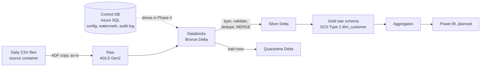
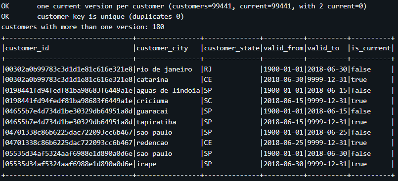
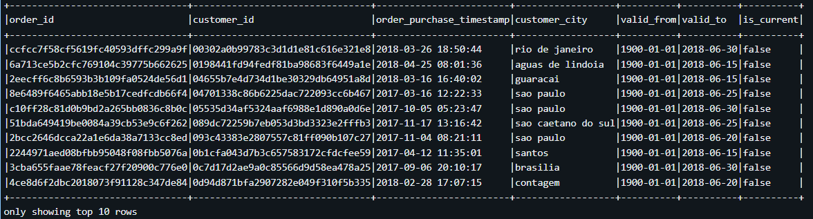
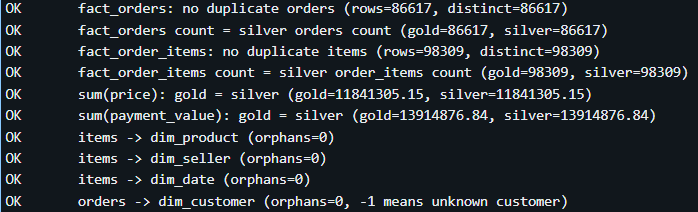
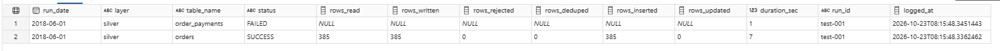

# Retail Lakehouse: Metadata-Driven Incremental Pipelines on Azure

An end-to-end data engineering project that builds a **Bronze / Silver / Gold lakehouse** on Azure using the Olist Brazilian e-commerce dataset. Files arrive as simulated daily batches and are loaded **incrementally and idempotently** by parameterized Databricks notebooks. The notebooks are designed to be driven by a **metadata control table**; ADF orchestration on top of it is the next phase.

> **Status:** Work in progress. Phases 1–3 are complete (ingestion, Bronze, Silver, data quality, Gold star schema with SCD Type 2). See the [Roadmap](#roadmap).

---

## Architecture



### Layers

| Layer | Container | Content |
|---|---|---|
| Source | `source` | Simulated external system (daily CSV files) |
| Raw | `raw` | Exact copy of the files, never edited (replay safety net) |
| Bronze | `bronze` | Delta, all columns as strings, plus technical columns |
| Silver | `silver` | Typed, validated, deduplicated Delta tables |
| Quarantine | `silver/_quarantine` | Rejected rows with the reason and the original row |
| Gold | `gold` | Star schema (dimensions and facts) and business aggregates |

---

## Tech stack

- Azure Data Lake Storage Gen2
- Azure Data Factory
- Azure Databricks
- PySpark
- Delta Lake
- Azure SQL Database (control and audit tables)
- Python
- SQL
- Git/GitHub

*Planned: Azure Key Vault, Power BI, CI/CD.*

---

## Dataset and daily-batch simulation

Source: [Olist Brazilian E-Commerce dataset](https://www.kaggle.com/datasets/olistbr/brazilian-ecommerce) on Kaggle.

The dataset is not included in this repo. Please download it from Kaggle.

Olist is a static dataset, so `data_prep/split_olist.py` turns it into a realistic daily feed:

- **History load:** everything before 2018-06-01 goes into one folder dated `2018-05-31`.
- **Daily files:** 1–30 June 2018, one folder per day: `ingestion_date=YYYY-MM-DD/`.
- **Order updates:** an order appears first as `created`, then again later with its final status. A `last_updated_ts` column is added as the watermark.
- **Simulated customer address changes** on six days (5, 10, 15, 20, 25 and 30 June), 30 customers each, to demonstrate SCD Type 2.

> The order updates and address changes are **simulated**. They are not original Olist events.

---

## Gold layer: star schema

```
               dim_date
                  |
dim_customer --- fact_orders           grain: one row per order
 (SCD Type 2)
dim_customer --- fact_order_items --- dim_product      grain: one row per order item
                       |
              dim_seller, dim_date
```

| Table | Type | Notes |
|---|---|---|
| `dim_date` | SCD1 | Built once, 2016–2019 |
| `dim_product` | SCD1 | Product plus English category name, rebuilt when Silver receives new data |
| `dim_seller` | SCD1 | Seller plus location |
| `dim_customer` | **SCD Type 2** | Versions with `valid_from`, `valid_to`, `is_current` |
| `fact_orders` | Fact | Payments, review score, delivery days, late flag |
| `fact_order_items` | Fact | Price, freight, links to all four dimensions |
| `agg_daily_sales`, `agg_monthly_category` | Aggregates | Ready for Power BI |

**Why two fact tables:** an order can contain several products and sellers, so product and seller cannot link to an order-level table. `fact_order_items` (one row per item) links to all dimensions; `fact_orders` (one row per order) holds payments, review, and delivery metrics.

**SCD Type 2 with one MERGE:** staged rows with the customer id as merge key match and close the current version; staged rows with a NULL merge key never match and are inserted as the new version. The source is Bronze, because Silver keeps only the latest address.

**Point-in-time join:** each order gets the customer version valid on its purchase date (`valid_from <= purchase date < valid_to`), so old orders keep the old address.

> **Limitation:** Olist creates a new `customer_id` for every order, so SCD Type 2 is tracked at `customer_id` level and most moved customers have only one order. A production design would track `customer_unique_id`, which is kept as a column for repeat-customer analysis.

---

## Repository structure

```
retail-lakehouse-azure/
├── README.md
├── .gitignore
├── data_prep/
│   └── split_olist.py            # builds daily batch files from the Kaggle CSVs
├── sql/
│   ├── 01_control_tables.sql     # ctl.pipeline_config + ctl.watermark_state
│   └── 02_audit_log.sql          # ctl.pipeline_run_log, usp_log_run, vw_latest_run
├── notebooks/
│   ├── 00_common.py              # paths, column types, data quality rules, gold helpers
│   ├── 01_bronze_ingest.py       # raw CSV -> Bronze Delta
│   ├── 02_silver_transform.py    # Bronze -> typed, validated, MERGE into Silver
│   ├── 03_dev_runner.py          # loops tables and dates (stands in for ADF during development)
│   ├── 04_gold_dimensions.py     # dim_date, dim_product, dim_seller, dim_customer (SCD2)
│   ├── 05_gold_facts.py          # fact_orders, fact_order_items (MERGE)
│   ├── 06_gold_aggregates.py     # business aggregates
│   ├── 07_gold_tests.py          # read-only validation tests
│   └── 08_gold_runner.py         # runs dimensions then facts for each day
└── DOCS/
    └── screenshots/
```

---

## Key design decisions

| Decision | Why |
|---|---|
| **Config table + state table are separate** | Config changes by deployment; watermark changes every run. Separate tables stop a config update from overwriting the watermark. |
| **Parameterized notebooks, metadata-driven by design** | The same notebooks handle all 9 tables; table name, keys, load type and watermark come in as parameters. For now a dev runner holds a copy of the config. In Phase 4, ADF will read `ctl.pipeline_config`, so adding a table means inserting one config row. |
| **Raw layer is a binary copy** | ADF does not parse anything, so raw stays exactly as received and odd characters cannot break the copy. |
| **Managed identity for storage access** | ADF and Databricks reach storage without keys to leak or rotate. (The SQL login is a password for now and moves to Key Vault later.) |
| **Loading never fails because of a bad value** | Typing happens in Silver; bad values become NULL and are flagged for quarantine. Blank strings are also converted to NULL, after my own test showed an empty `order_id` passing the NOT NULL rule. |
| **Two watermarks** | Ingestion date is the file-level watermark (which day to load). `last_updated_ts` is the record-level watermark (which version is newest). |
| **MERGE with `s.last_updated_ts >= t.last_updated_ts`** | A late or old file cannot overwrite a newer record. |
| **Deduplicate before MERGE** | Delta MERGE fails when two source rows match one target row. |
| **Full vs incremental** | Full tables are replaced with a snapshot. Incremental tables are upserted with MERGE. |
| **Hash surrogate keys (`xxhash64`)** | The same business key gives the same key on every run, so reruns never change keys and facts need no lookup. |
| **Facts rebuilt from Silver for touched orders, then MERGE** | An order's status and review arrive on different days; any of those events refreshes the order, and the result is the same however often it runs. |
| **Audit table in Azure SQL** | Every notebook returns the same count fields, so ADF can log each run through one stored procedure (Phase 4). |

---

## Idempotency

Re-running the same day must not create duplicates:

- **Bronze:** `replaceWhere` on `_ingestion_date` replaces only that day's rows.
- **Silver:** MERGE on the primary key updates the same row.
- **Quarantine:** `replaceWhere` on `_ingestion_date` clears and rewrites that day's rejects.
- **Gold:** facts are rebuilt and MERGEd on their keys; `dim_customer` creates no new version when the current one already matches. Re-run only the latest processed day, because SCD Type 2 compares against the current version.

---

## Data quality and quarantine

Each table has rules (not null, valid status values, non-negative amounts, score between 1 and 5, valid ranges). Rows that fail a rule or fail type casting go to a **quarantine table** instead of stopping the pipeline. Each quarantined row keeps:

- `_dq_failed_rules`: the list of failed rules
- `_raw_json`: the original row exactly as it arrived
- `_ingestion_date`, `_silver_run_id`, `_quarantined_at`

Every Silver run returns row counts that reconcile:

```
rows_read = rows_rejected + rows_written + rows_deduped
```

---

## Verified results

### Bronze and Silver

**Daily batches in the raw layer**


**Metadata-driven config table**


**History load: row counts reconcile**


**Order status change: Bronze keeps both versions, Silver keeps the latest**


**Reconciliation and idempotency**


**Quarantine: rejected rows with failed rules and original row**


### Gold

| Check | Result |
|---|---|
| `dim_customer`: one current version per customer | 99,441 customers, 99,441 current versions, `customer_key` unique |
| Customers with a second version (SCD Type 2) | 180 (6 change days x 30 customers) |
| `fact_orders` vs Silver orders | 86,617 = 86,617, no duplicates |
| `fact_order_items` vs Silver order items | 98,309 = 98,309, no duplicates |
| Sum of item price: Gold vs Silver | 11,841,305.15 = 11,841,305.15 |
| Sum of payment value: Gold vs Silver | 13,914,876.84 = 13,914,876.84 |
| Orphan keys (items to product, seller, date; orders to customer) | 0 |
| Re-run of the last day | Row counts unchanged |

**SCD Type 2: customer address history**



**Point-in-time join: each order keeps the address that was valid on its purchase date**



**Gold validation tests**



**Audit view (`ctl.vw_latest_run`, shown with two test rows)**



---

## How to run

1. Create an Azure resource group with ADLS Gen2 storage (hierarchical namespace on), Data Factory, Databricks workspace, and Azure SQL Database.
2. Create containers: `source`, `raw`, `bronze`, `silver`, `gold`.
3. Download the Olist CSVs into `olist_raw/` and run:

   ```bash
   python data_prep/split_olist.py
   ```

4. Upload the output to the `source` container.
5. Run `sql/01_control_tables.sql` and `sql/02_audit_log.sql` on the Azure SQL database (in separate blocks if the portal editor rejects `GO`).
6. In ADF, copy `source` to `raw` (binary, preserve hierarchy).
7. Give Databricks access to storage (Access Connector + Unity Catalog external locations for raw, bronze, silver and gold).
8. Import the notebooks into one Databricks folder and set `STORAGE_ACCOUNT` in `00_common.py`.
9. Run the load cells in `03_dev_runner.py` (Bronze and Silver), then `08_gold_runner.py` (Gold), both day by day in date order. The test cells write and delete files, so run them one at a time, not with "Run all".
10. Run `06_gold_aggregates.py` once, then `07_gold_tests.py`.

---

## Cost notes

Single-node cluster, Photon off, auto-terminate at 15 minutes. All resources in one resource group that is deleted when the project ends. Databricks trial DBUs are free, but the Azure VM is always billed, so I tracked cluster hours daily. The workspace uses my own virtual network, so it needs a NAT gateway for outbound access, which bills hourly while it exists.

---

## Roadmap

- [x] **Phase 1:** Azure setup, ADLS layout, daily file simulation, control tables, ADF connections
- [x] **Phase 2:** Bronze, Silver, data quality, quarantine, idempotency tests
- [x] **Phase 3:** Gold star schema, SCD Type 2, Delta MERGE, aggregates, audit log table
- [ ] **Phase 4:** Metadata-driven ADF pipeline, triggers, retries, failure alerts, audit logging
- [ ] **Phase 5:** Performance tuning (partitioning, OPTIMIZE, Z-ORDER, before/after), Key Vault, Git integration, CI/CD, Power BI dashboard

---

## Author

**D Shiva Prasad** · Data Engineer · [LinkedIn](https://www.linkedin.com/in/d-shiva-prasad/) · dshiva065@gmail.com
